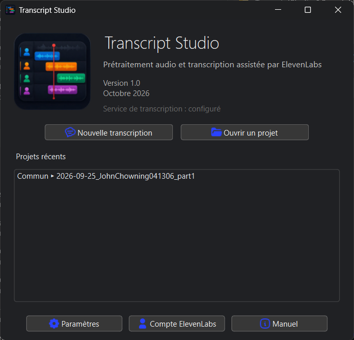
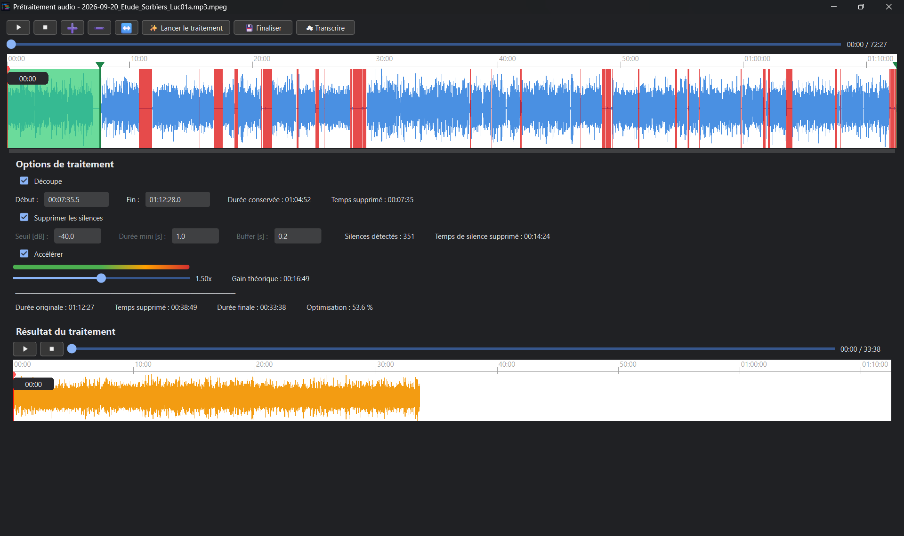
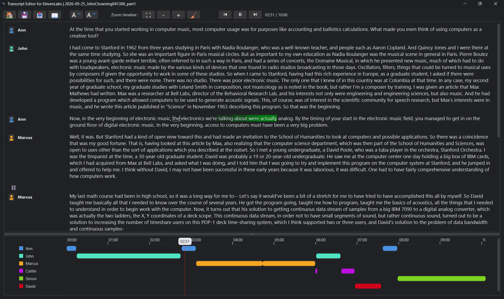

# Transcript Studio

Transcript Studio est une application de bureau Windows dédiée au prétraitement audio, à la transcription via l’API ElevenLabs Speech-to-Text et à la relecture/correction des transcriptions obtenues.

Le dépôt contient les **sources** du projet et les scripts permettant de produire les **exécutables Windows 1.0** (installateur et archive portable). Les exécutables compilés ne sont pas stockés dans le dépôt : ils sont construits depuis les sources (voir la section « Build Windows ») et diffusés via les releases GitHub (voir la section « Installation »).

## Captures d’écran








## Fonctionnalités principales

### Prétraitement audio

Transcript Studio permet de préparer un enregistrement avant transcription :

- découpe du début et de la fin ;
- détection et suppression des silences ;
- conservation d’un buffer autour des silences supprimés ;
- accélération de l’audio ;
- visualisation de la forme d’onde ;
- comparaison et écoute du résultat avant transcription.

Le fichier original est conservé. Le traitement génère un fichier audio distinct destiné à la transcription.

### Transcription ElevenLabs

Transcript Studio utilise directement l’API ElevenLabs Speech-to-Text. Une clé API ElevenLabs personnelle est nécessaire pour effectuer une nouvelle transcription.

L’interface permet notamment de définir :

- la langue ou l’auto-détection ;
- le modèle de transcription ;
- la diarisation ;
- la reconnaissance des intervenants connus ;
- la détection des rôles ;
- des mots-clés personnalisés.

### Éditeur de transcription

Après transcription, l’éditeur permet notamment de :

- relire la transcription de façon synchronisée avec l’audio ;
- visualiser le mot correspondant à la position de lecture ;
- modifier ou supprimer un mot ;
- séparer des blocs de parole ;
- fusionner des blocs appartenant au même intervenant ;
- réaffecter un bloc à un autre intervenant ;
- créer et renommer des intervenants ;
- supprimer les intervenants inutilisés ;
- modifier la taille du texte ;
- naviguer dans la transcription à l’aide d’une timeline ;
- sauvegarder le projet ;
- exporter la transcription.

### Timeline

La timeline représente chronologiquement les blocs de parole. Chaque intervenant possède une couleur et une ligne dédiées, ce qui permet d’identifier rapidement qui intervient et à quel moment dans l’enregistrement.

### Export

Les formats d’export actuellement proposés sont :

- TXT ;
- JSON ;
- DOCX ;
- PDF.

Selon le format, les intervenants et les horodatages peuvent être inclus.

La fin de l’export est signalée à l’utilisateur, avec possibilité d’ouvrir directement le fichier créé ou son dossier.

## Études et navigation v2

L’application s’organise en quatre pages : **Accueil**, **Réunion**, **Étude**, **Ouvrage** (la page Ouvrage complète arrive avec P19/P20 ; l’assemblage et l’export final de l’ouvrage s’y font déjà).

### Accueil (hub)

- Trois grandes tuiles : « Nouvelle transcription », « Reprendre une réunion », « Études » — une étude est un regroupement de réunions ayant pour objet un thème spécifique ;
- bandeau de l’application (logo, « Version 2.0 », pastilles de services « Transcription ElevenLabs » et « Service IA » — verte si configuré, grise sinon) : il n’apparaît que sur l’accueil ;
- « Dernières réunions » : chaque mini-tuile affiche le titre, l’étude de rattachement (ou « Réunion autonome », avec un lien « rattacher à une étude… »), le stepper compact et le coût des traitements ;
- la tuile « Études » ouvre une vue dédiée (liste des études, « Nouvelle étude », « Ouvrir depuis un dossier… ») — le hub reste épuré.

### Page Réunion

- Ruban : titre de la réunion (configurable), date · durée, badge d’étude et de Bible au nom court (ou « Réunion autonome »), boutons « Gestion de l’étude », « Accueil », « ⚙ », « ? » ;
- **stepper compact, uniquement une fois la transcription réalisée** : ① Transcription · ② Reformulation · ③ Résumé · ④ Export. Les étapes **② Reformulation et ③ Résumé sont optionnelles** : le bouton unique « Étape suivante : … (optionnelle) › » les annonce, et le saut d’étape se fait par clic direct sur une pastille ;
- la pastille « Transcription » ouvre l’**éditeur de correction** : bleue tant que la correction est en cours, verte une fois la diarisation validée ;
- une réunion non transcrite n’affiche pas de stepper (mention « transcription en attente ») ; la fenêtre de préparation audio reste linéaire, et transcrire un audio **déjà prétraité** lors d’une session précédente revient à une transcription directe ;
- ④ Export : export de la transcription corrigée (flux v1), ou des **textes validés de la réunion** (résumé validé en tête, reformulations validées dans l’ordre d’ouvrage) — y compris pour une réunion autonome ou un état intermédiaire.

### Réunion : objet de premier rang

- Une réunion existe de façon autonome ou appartient à **exactement une étude** ;
- « Rattacher à une étude… » est disponible à tout moment, dès le prétraitement (hub, page Réunion) ;
- changer d’étude demande confirmation : **les traitements déjà réalisés restent à l’ancienne étude** (aucun déplacement, aucune copie) ;
- détacher une réunion la rend autonome, là aussi sans toucher aux traitements.

### Page Étude

- Ruban : titre, thème, nombre de réunions, badge court « Bible : Darby révisée · versification : Darby », boutons « Modifier l’étude », « Accueil », « ⚙ », « ? » ;
- liste des réunions en une colonne : titre lisible, rang (Réunion 1, 2, …), date de réunion (date de l’audio), durée, avancement Transcription → Reformulation → Résumé (l’export de réunion n’y figure pas : l’objectif d’une étude est l’ouvrage), coût, bouton « Ouvrir », poignée de réordonnancement — l’ordre vaut ordre d’ouvrage ;
- « ＋ Ajouter une réunion » (en tête de liste, à côté du titre « Réunions de l’étude ») : depuis un fichier, depuis une réunion autonome, ou nouvel audio ;
- synthèse d’étude (« Régénérer… » ou « Éditer » à la main) et récurrences ;
- le bouton « Ouvrage… » renvoie vers la page Ouvrage : l’assemblage et l’export final de l’étude s’y font.

### Saisie manuelle (sans IA)

Tout bloc reformulé et tout résumé peut être **saisi ou collé directement, sans aucun appel LLM** (édition libre → « Sauvegarder » = nouvelle version). Un contenu validé saisi à la main a exactement le même statut qu’un contenu validé après traitement IA : il entre dans la compilation de l’ouvrage au même titre. Toute saisie manuelle est tracée dans le log des opérations (« édition manuelle »).

## Formats multimédias pris en charge

### Audio

- WAV
- MP3
- M4A
- AAC
- FLAC
- OGG
- OPUS

### Vidéo

- MP4
- MOV
- MKV
- AVI
- WEBM
- MPEG
- MPG
- TS
- M2TS

Les fichiers vidéo passent obligatoirement par le prétraitement afin d’en extraire une piste audio avant transcription.

## Installation

Transcript Studio peut être installé de deux manières : à partir des **exécutables Windows 1.0** (installateur ou version portable), ou **depuis les sources** (à réserver au développement ou aux environnements spécifiques).

### Option 1 : installation Windows (exécutables 1.0)

Les deux variantes embarquent l’application complète : binaire Nuitka standalone, FFmpeg, icônes et manuel utilisateur PDF. Les sommes SHA-256 des artefacts sont détaillées dans la section « Build Windows ».

#### Installateur (recommandé)

1. Télécharger `TranscriptStudio-1.0-setup.exe` depuis la release GitHub `v1.0`.
2. Exécuter le fichier. L’installation étant « per machine » (répertoire Program Files), Windows demande une élévation de privilèges (UAC) : valider par « Oui ».
3. Suivre l’assistant d’installation en français : répertoire d’installation, raccourci bureau (facultatif).
4. Lancer Transcript Studio depuis le menu Démarrer.
5. La désinstallation s’effectue depuis « Applications et fonctionnalités » ou le groupe « Transcript Studio » du menu Démarrer. Elle ne supprime ni les projets ni les paramètres de l’utilisateur.

#### Version portable

1. Télécharger `TranscriptStudio-1.0-portable.zip` depuis la release GitHub `v1.0`.
2. Extraire l’archive dans un répertoire de votre choix.
3. Lancer directement `TranscriptStudio.exe` : aucune installation, aucune élévation de privilèges, aucune écriture dans le registre.
4. Pour supprimer l’application, supprimer le répertoire extrait.

Remarque : même en version portable, les paramètres et projets sont conservés dans les données utilisateur Windows (`AppData\Local\DFrechet\TranscriptStudio`) ; ils ne sont pas supprimés avec le répertoire de l’application.

#### Avertissement Windows SmartScreen

L’exécutable n’est pas signé (pas de certificat de signature de code). Au premier lancement, Windows peut afficher « Windows a protégé votre PC ». Il s’agit d’un avertissement de réputation, pas d’une détection d’antivirus. Contournement : « Informations complémentaires » puis « Exécuter quand même ». Ce message disparaît à mesure que la réputation du fichier se construit. Le sujet est détaillé dans le manuel utilisateur (section « Installation »).

### Option 2 : installation depuis les sources

#### Prérequis

- Windows ;
- Python 3.11.15 (les autres versions de Python 3.11 ne sont pas nécessairement incompatibles, mais elles n’ont pas été validées) ;
- dépendances Python listées dans `requirements.txt` ;
- FFmpeg installé dans l’arborescence du projet (étape suivante) ;
- connexion Internet et clé API ElevenLabs pour les fonctions de transcription.

#### 1. Cloner le dépôt

```powershell
git clone https://github.com/TranscriptStudio/TranscriptStudio.git
cd TranscriptStudio
```

#### 2. Créer un environnement Python isolé

Avec Conda :

```powershell
conda create -n transcript-studio python=3.11.15 pip -c conda-forge --override-channels
conda activate transcript-studio
```

Une autre méthode de création d’environnement virtuel peut être utilisée à condition de disposer d’un environnement Python compatible.

#### 3. Installer les dépendances

```powershell
python -m pip install -r requirements.txt
```

Vérification recommandée :

```powershell
python -m pip check
```

Les dépendances Python directes actuellement déclarées sont :

- PySide6 6.11.2 ;
- NumPy 2.4.6 ;
- Requests 2.34.2 ;
- python-docx 1.2.0 ;
- ReportLab 5.0.1 ;
- platformdirs 4.11.5 ;
- pyqtgraph 0.14.0.

Les outils nécessaires uniquement au développement sont séparés dans `requirements-dev.txt`.

Pour les installer :

```powershell
python -m pip install -r requirements-dev.txt
```

#### Installation de FFmpeg (sources uniquement)

FFmpeg est nécessaire au prétraitement et à la conversion des fichiers audio/vidéo. Cette étape ne concerne que l’installation depuis les sources : les exécutables Windows 1.0 embarquent déjà FFmpeg.

L’exécutable FFmpeg n’est pas fourni dans ce dépôt.

Sous Windows, télécharger le package **release essentials** depuis :

https://www.gyan.dev/ffmpeg/builds/

Dans la section `release builds`, télécharger :

```text
ffmpeg-release-essentials.zip
```

La page affiche la version la plus récente ainsi qu’une somme SHA-256 de l’archive : vérifier ces informations avant le téléchargement.

Après extraction de l’archive, récupérer :

```text
ffmpeg.exe
```

et le copier dans :

```text
tools/ffmpeg/
```

La structure attendue est :

```text
TranscriptStudio/
├── tools/
│   └── ffmpeg/
│       └── ffmpeg.exe
│
├── models/
├── services/
├── ui/
├── requirements.txt
└── TranscriptStudio.py
```

Vérifier ensuite depuis PowerShell :

```powershell
.\tools\ffmpeg\ffmpeg.exe -version
```

Le code de Transcript Studio recherche l’exécutable d’abord dans `tools/ffmpeg/windows/`, puis à cet emplacement, avant de se replier sur le chemin configuré dans les paramètres et enfin sur le `PATH` système.

#### Installation des Bibles (téléchargeur intégré, facultative)

La **Bible au format OSIS XML** est une ressource facultative utilisée par le contrôle qualité des références et des citations (version 2) : extrait de vérification d’une référence complétée, comparaison des citations au texte biblique, alignement à la demande.

Trois versions sont gérées (spécification P18.5) :

| Identifiant | Version | Source | Licence |
|---|---|---|---|
| `darby` | Bible J. N. Darby (éd. 2024, rév. 2.0) | concordance.bible (miroir BPC), zip OSIS | Domaine public |
| `darbyR` | Bible J. N. Darby révisée (éd. 2026, rév. 2.3) | concordance.bible (miroir BPC), zip OSIS | CC BY NC ND |
| `segond1910` | Bible Segond 1910 | aucun lien direct vérifié : import manuel | Domaine public |

**Téléchargeur intégré** : Réglages de l’application, onglet « Bibles » — bouton « Télécharger » pour Darby et Darby révisée (progression, annulation, aucune trace en cas d’échec), bouton « Charger depuis un fichier… » pour un fichier OSIS déjà téléchargé (notamment Segond 1910, depuis https://concordance.bible). Aucun téléchargement n’a jamais lieu en silence : toujours à la demande.

**Version retenue par étude** : les paramètres de l’étude proposent un déroulant « Bible de référence » (défaut : Darby révisée). Le contrôle qualité travaille toujours contre la version retenue par l’étude ; une étude existante sans ce réglage utilise le défaut, sans migration. Une référence introuvable dans la version retenue est une information consultable dans les autres versions installées (versifications différentes), jamais une décision automatique.

Les fichiers Bible vivent dans `resources/bible/`, ne sont **jamais commités** (volume et licences, ignorés par `.gitignore`) :

```text
resources/bible/Darby.osis.xml       # version « darby »
resources/bible/DarbyR.osis.xml      # version « darbyR »
resources/bible/Segond1910.osis.xml  # version « segond1910 » (import manuel)
resources/bible/JND.osis.xml         # choix explicite hérité (prime pour un chargement implicite hors étude)
```

Sans Bible installée, l’application fonctionne normalement ; le contrôle qualité des références reste local (extraction et comparaison source ↔ résultat) mais ne peut afficher ni extrait biblique, ni proposer l’alignement des citations.

## Configuration ElevenLabs

Transcript Studio utilise l’API ElevenLabs Speech-to-Text pour produire les transcriptions.

Une clé API ElevenLabs est donc nécessaire pour lancer une nouvelle transcription.

Après démarrage de l’application :

```text
Accueil
→ Paramètres
→ Clé API ElevenLabs
```

Renseigner la clé puis utiliser `Tester la connexion`.

La clé API est enregistrée dans les données utilisateur locales de Transcript Studio et ne doit jamais être ajoutée au dépôt Git.

L’utilisation de l’API ElevenLabs est soumise aux conditions, limites et éventuels coûts du service ElevenLabs. Transcript Studio est un projet indépendant et n’est ni affilié à, ni sponsorisé, ni approuvé par ElevenLabs.

Documentation officielle Speech-to-Text :

https://elevenlabs.io/docs/overview/capabilities/speech-to-text

## Lancement

### Installation Windows

Lancer `TranscriptStudio.exe` depuis le menu Démarrer (installateur) ou depuis le répertoire extrait de l’archive (version portable).

### Depuis les sources

Depuis la racine du projet et après activation de l’environnement :

```powershell
python TranscriptStudio.py
```

Au premier lancement, Transcript Studio demande de choisir le répertoire racine des projets ; la clé API ElevenLabs est facultative à ce stade. L’application crée ensuite son répertoire de données utilisateur.

## Organisation des projets

Le répertoire racine des projets peut être modifié depuis les paramètres.

Les projets peuvent être classés dans différents sous-répertoires. Le sous-répertoire `Commun` est créé et utilisé comme classement par défaut.

Exemple :

```text
Projects/
├── Commun/
│   └── 2026-09-25_Enregistrement/
│       ├── enregistrement.mp3
│       ├── project.sttproj
│       └── transcription.json
├── Projet_A/
└── Projet_B/
```

Lors d’un prétraitement, un fichier audio final optimisé peut également être conservé dans le dossier projet.

## Fichiers projet

Les projets Transcript Studio utilisent l’extension :

```text
.sttproj
```

Le fichier projet contient notamment les données nécessaires à la reconstruction de la transcription :

- informations générales ;
- référence au fichier audio ;
- langue ;
- intervenants ;
- couleurs ;
- mots et horodatages ;
- blocs de parole ;
- réponse issue de la transcription ElevenLabs.

## Thèmes

Trois modes d’affichage sont disponibles :

- Système ;
- Clair ;
- Sombre.

Le mode Système adapte le thème en fonction du mode détecté par l’application.

## Structure générale du projet

```text
TranscriptStudio/
├── architecture/
├── docs/
├── icons/
├── models/
├── services/
├── test/
├── tools/
│   └── ffmpeg/
├── ui/
├── requirements.txt
├── requirements-dev.txt
└── TranscriptStudio.py
```

### `models/`

Modèles de données utilisés pour représenter notamment les projets, intervenants, mots, blocs de transcription et paramètres de traitement audio.

### `services/`

Services techniques et métier :

- gestion des projets et paramètres ;
- intégration avec l’API ElevenLabs ;
- prétraitement audio ;
- FFmpeg ;
- détection et suppression des silences ;
- lecture audio ;
- sauvegarde ;
- export.

### `ui/`

Fenêtres, dialogues et composants graphiques PySide6.

### `icons/`

Ressources graphiques de l’application. Certaines icônes SVG proviennent de Tabler Icons.

### `docs/`

Documentation utilisateur de l’application.

### `tools/ffmpeg/`

Emplacement attendu pour `ffmpeg.exe`. Cet exécutable n'est pas stocké dans le dépôt Git.

## Développement

Les dépendances supplémentaires utilisées pour les tests et certains outils de développement sont déclarées dans :

```text
requirements-dev.txt
```

Installation :

```powershell
python -m pip install -r requirements-dev.txt
```

Le fichier inclut `requirements.txt`, il n’est donc pas nécessaire d’installer les deux séparément dans un environnement de développement neuf.

## Build Windows

La version 1.0 est distribuée sous deux formes, produites depuis les sources du dépôt :

| Artefact | Contenu | Taille | SHA-256 | Téléchargement |
| --- | --- | --- | --- | --- |
| `TranscriptStudio-1.0-setup.exe` | Installateur Inno Setup, per-machine (Program Files, raccourcis, désinstallation propre) | 81 Mo | `00a78687c4487732cb51960a47ecd0cec6b2613daababdf987cb83b9f7399a93` | [Release v1.0](https://github.com/TranscriptStudio/TranscriptStudio/releases/download/v1.0/TranscriptStudio-1.0-setup.exe) |
| `TranscriptStudio-1.0-portable.zip` | Archive portable sans installation ni modification du système | 114 Mo | `fd07304883c4b01073b02a8e0a8079ac3be67ede81ff93914ab323b333587ef7` | [Release v1.0](https://github.com/TranscriptStudio/TranscriptStudio/releases/download/v1.0/TranscriptStudio-1.0-portable.zip) |

Les liens de téléchargement pointent vers la release GitHub `v1.0` et deviennent actifs à la publication de celle-ci.

Les deux artefacts embarquent l’application complète : binaire Nuitka standalone, FFmpeg (`tools/ffmpeg/windows/ffmpeg.exe`), icônes et manuel utilisateur PDF.

### Reproduire le build

Le build nécessite un **CPython 3.11 standard** (une distribution Anaconda/conda ne fonctionne pas : `import ctypes` y provoque un arrêt fatal dans le binaire standalone) et **Nuitka 4.3.1 ou plus récent** (la version 4.3 provoque un crash natif de l’application à l’export Word et PDF). Procédure :

```powershell
# 1. Environnement de build propre
uv venv --python 3.11 TranscriptStudio_buildenv
uv pip install --python TranscriptStudio_buildenv/Scripts/python.exe -r requirements.txt nuitka ordered-set zstandard

# 2. Binaire standalone Nuitka (MSVC requis) -> build\TranscriptStudio.dist\
tools\build_windows.bat TranscriptStudio_buildenv\Scripts\python.exe

# 3. Installateur Inno Setup (Inno Setup 6 requis) -> dist\TranscriptStudio-1.0-setup.exe
ISCC.exe tools\installer_windows.iss
```

### Analyse VirusTotal

Les exécutables 1.0 ne sont pas signés et obtiennent de façon récurrente des scores heuristiques de machine learning. Analyse du 11/10/2026 sur le `TranscriptStudio-1.0-setup.exe` de cette même version (SHA-256 `2e0de8c2cf626869a0d600c3e4c41ad975bef6dca36c2ce9ec8a7679f9aceb94`) :

- **2 moteurs sur 68** signalaient le fichier : Arctic Wolf (`Unsafe`) et Trapmine (`Suspicious.low.ml.score`) ;
- il s’agit de scores heuristiques de machine learning, typiques des faux positifs sur binaires non signés ;
- tous les moteurs majeurs (Microsoft, Kaspersky, ESET, Bitdefender, Avast…) étaient **non détectés** ;
- l’analyse complète : `https://www.virustotal.com/gui/file/2e0de8c2cf626869a0d600c3e4c41ad975bef6dca36c2ce9ec8a7679f9aceb94`

Une analyse du fichier effectivement téléchargé reste recommandée.

L’exécutable n’étant pas signé (pas de certificat de signature de code), Windows SmartScreen peut afficher « Windows a protégé votre PC » au premier lancement d’une nouvelle version. Le contournement (« Informations complémentaires → Exécuter quand même ») est documenté dans le manuel utilisateur (section « Installation »).

## Composants et services tiers

Transcript Studio repose sur plusieurs projets et services tiers qui conservent leurs licences, marques et conditions d’utilisation respectives.

### Tabler Icons

Certaines icônes SVG utilisées dans l’interface proviennent de Tabler Icons.

Tabler Icons est distribué sous licence MIT.

Copyright (c) 2020-2026 Paweł Kuna

Projet :

https://github.com/tabler/tabler-icons

Licence :

https://github.com/tabler/tabler-icons/blob/main/LICENSE

La notice de licence et de copyright de Tabler Icons doit être conservée conformément aux conditions de la licence MIT.

### ElevenLabs

Transcript Studio utilise l’API ElevenLabs Speech-to-Text comme service externe de transcription.

ElevenLabs reste une marque et un service indépendants de Transcript Studio. L’utilisation de son API nécessite un compte et une clé API valides et reste soumise aux conditions du service ElevenLabs.

Transcript Studio n’est ni affilié à, ni sponsorisé, ni approuvé par ElevenLabs.

### FFmpeg

FFmpeg est un projet tiers indépendant de Transcript Studio.

Les binaires FFmpeg et FFprobe ne sont pas stockés dans le dépôt source : l’installateur et l’archive portable Windows 1.0, en revanche, **redistribuent** `ffmpeg.exe` (build `9.0.2-essentials` de gyan.dev, compilée avec `--enable-gpl --enable-version3`, donc soumise à la GPL version 3 ou ultérieure). Cette redistribution est compatible avec la licence GPL-3.0 du projet.

Sources FFmpeg officielles :

https://ffmpeg.org/download.html

Builds Windows redistribués :

https://www.gyan.dev/ffmpeg/builds/

Informations officielles :

https://ffmpeg.org/

https://ffmpeg.org/legal.html

### Dépendances Python

Les bibliothèques Python installées via `requirements.txt` restent soumises à leurs licences respectives. La licence de Transcript Studio ne remplace pas les conditions applicables aux composants tiers.

## Licence de Transcript Studio

Copyright © 2026 David FRECHET

Transcript Studio est destiné à être distribué sous la **GNU General Public License version 3 uniquement (`GPL-3.0-only`)**.

Cette licence autorise notamment l’utilisation, l’étude, la modification et la redistribution du logiciel sous les conditions de la GPLv3. Lorsqu’une version couverte par la GPL est redistribuée, les obligations prévues par cette licence doivent être respectées.

Le texte officiel complet de la GNU GPL version 3 est fourni dans le fichier `LICENSE` à la racine du dépôt.

Référence officielle :

https://www.gnu.org/licenses/gpl-3.0.html

Les composants tiers utilisés par Transcript Studio restent soumis à leurs propres licences.

## État du projet

Version affichée actuellement dans l’application :

```text
1.0
Octobre 2026
```

La version 1.0 (Windows) a été validée par :

- build Nuitka standalone reproductible depuis un environnement propre ;
- installation/désinstallation de l’installateur (Program Files, raccourcis, registre) ;
- test fonctionnel du binaire installé et de la version portable (lecture audio, édition, réouverture de projet, changement de thème) ;
- export des quatre formats testé dans le binaire compilé (TXT, JSON, DOCX, PDF) ;
- analyse VirusTotal de l’installateur (2/68, faux positifs heuristiques, voir « Build Windows »).

Reste à valider avant diffusion large : test sur une machine Windows vierge sans environnement de développement.

## Auteur

David FRECHET

## Avertissement

La transcription automatique peut contenir des erreurs. Le texte et l’attribution des interventions aux différents locuteurs doivent être contrôlés avant utilisation.

Transcript Studio fournit des fonctions de relecture, correction et réaffectation des intervenants afin de faciliter ce contrôle.
