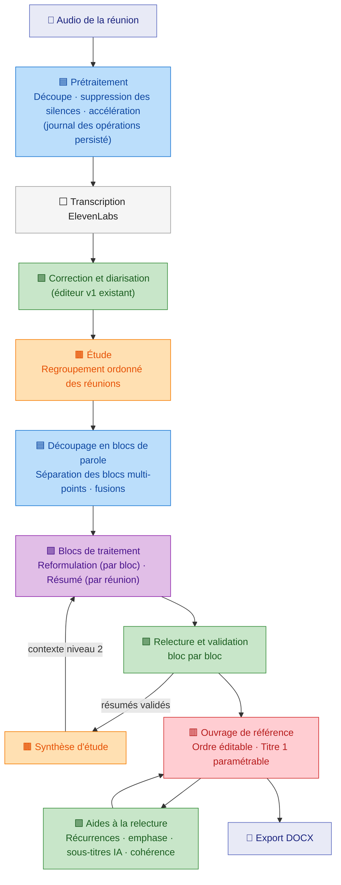
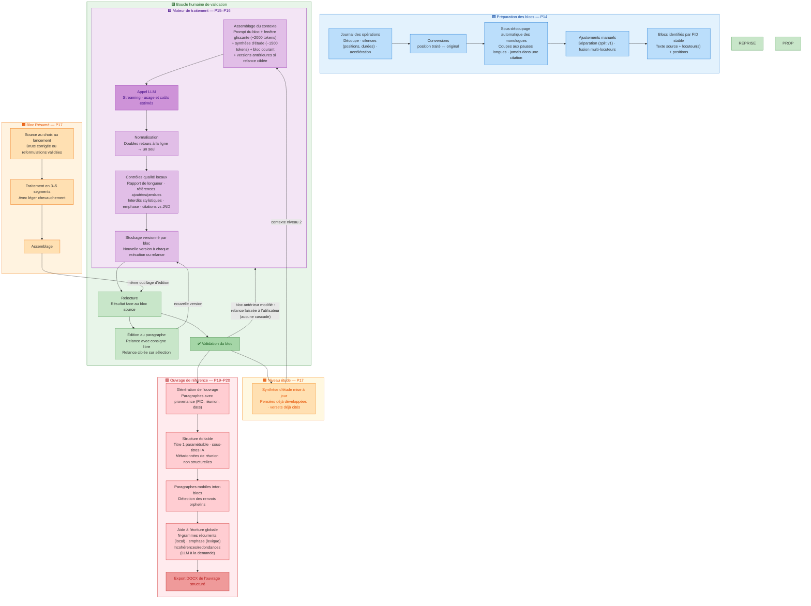

# TranscriptStudio v2 — Workflow

Deux vues du même workflow : une vue d'ensemble (le pipeline de bout en bout) et une vue détaillée (mécanismes internes du moteur de traitement, de la validation et de la construction de l'ouvrage). Chaque couleur identifie une zone du système.

**Code couleur** : 🟦 préparation des données · 🟪 moteur de traitement (IA) · 🟩 boucle humaine · 🟧 bloc Résumé · 🟫 niveau étude · 🟥 ouvrage de référence · ⬜ entrées/sorties.

## Vue d'ensemble — du fichier audio à l'ouvrage

Le pipeline en une phrase : l'audio devient transcription corrigée, la réunion rejoint une étude, les blocs de parole sont reformulés ou résumés avec un contexte hiérarchique (fenêtre glissante + synthèse d'étude), l'utilisateur valide, les textes validés alimentent la synthèse d'étude et l'ouvrage de référence, qui s'exporte en DOCX.

## Vue détaillée — mécanismes internes

Points de lecture :

- **La fenêtre glissante n'utilise que ce qui est validé ou produit en amont** : en passe complète, chaque bloc est traité avec les résultats frais des précédents ; en reprise (bloc antérieur modifié), avec les textes validés seulement.
- **La boucle humaine est le cœur du système** : stockage versionné → relecture → édition ou relance (globale, ciblée sur sélection) → validation → reprise éventuelle des blocs suivants. Aucun texte non validé ne sort vers l'ouvrage.
- **Deux contextes, deux niveaux** : la fenêtre glissante assure la continuité au sein d'une réunion (violet) ; la synthèse d'étude assure la continuité entre réunions (orange — elle sait ce qui a déjà été développé).
- **L'ouvrage est un document dérivé autonome** : généré depuis les blocs validés, chaque paragraphe garde sa provenance, puis il vit sa propre vie (structure, déplacements, aides à la relecture) indépendamment des régénérations de réunion.